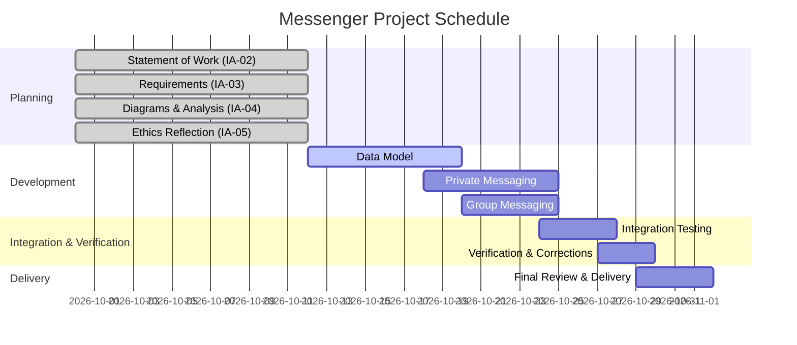

# Statement of Work

## Messenger

> **Document Status:** Draft  
> **Student:** Caitlyn Andrade  
> **Faculty Mentor:** Nick Stiffler  
> **Project Period:** 9/30 - 11/2  
> **Expected Effort:** 5-10 hours per week  
> **Version:** 0.1  
> **Last Updated:** 10/12  

---

## 1. Project Purpose and Objectives

Messenger is a lightweight communication application intended to support direct private messaging and group-based
messaging among registered users. The client's goal is to obtain a functional, reviewable messaging system that
demonstrates reliable communication, clear scope boundaries, and defensible engineering decisions.

The project addresses the need for a simple, focused communication tool without the complexity or feature bloat of 
large commercial platforms. The primary objectives are:

- Provide a secure, reliable channel for private messages between two registered users.
- Provide group-based messaging that allows multiple users to participate in shared conversations.
- Deliver a system with clearly defined scope, traceable reuirements, and reviewable artifacts.
- Produce a working prototype suitable for evaluation by November 2, 2026.

---

## 2. Stakholders

| Stakeholder | Relationship to Project |
|---|---|
| Client | Defines the project goals and approves deliverables. |
| End Users | Registered users who send and receive private and group messages. |
| System Administrator | Manages user accounts, group membership, and operational policies. |
| Engineering Team | Designs, implements, documents, and verifies the Messenger system. |
| Instructor | Evaluates artifacts and ensures project alignment with course standards. |

---

## 3. Scope

### In-Scope Functionality

The Messenger project will include:

- User registration and authentication.
- Sending and receiving private messages.
- Creating and participating in group conversations.
- Basic group membership management (join, leave, view members).
- Persistent storage of messages and user information.
- Delivery of required engineering artifacts (requirements, diagrams, analysis, ethics reflection).
- A functional prototype demonstrating core messaging behavior.

### Explicitly Out-of-Scope

To maintain a defensible boundary, the following are **not** included:

- Voice or video communication.
- Rich media sharing (images, files, screen sharing).
- Advanced moderation tools (auto-flagging, content filtering).
- Full Discord-like feature sets (roles, bots, channels, permissions hierarchy).
- Mobile applications or cross-platform deployment.
- End-to-end encryption beyond basic secure transport assumptions.
- Enterprise-scale scalability or performance guarantees. 

---

## 4. Deliverables

The project will produce the following reviewable artifacts:

- **Functional Messenger prototype** implementing private and group messaging.
- **Statement of Work (!A-02)**
- **Requirements document (IA-03)**
- **Data Flow Diagram and Sequence Diagram (IA-04)**
- **Modeling analysis (IA-04)**
- **Ethics Reflection (IA-05)**
- **Gantt chart and schedule source**
- **Repository containing all artifacts, diagrams, and source code**

---

## 5. Assumptions, Constraints, and Dependencies

### Assumptions

- Users have access to a modern web browser or desktop environment.
- The system will operate in a controlled environment suitable for a course project.
- Message volume will be moderate and not require enterprise-level scaling.
- The client accepts a prototype rather than a production-ready system. 

### Constraints

- **Final delivery deadline: November 2, 2026**
- All artifacts must be committed and pushed to the GitHub repository before deadlines.
- The system must support private and group messaging at minimum.
- The project must remain consistent across all four assignments.

### Dependencies

- Github repository provisioned by the instructor.
- Any libraries, frameworks, or runtime environments chosen during development.
- Stakeholder clarification for unresolved questions discovered during requirements analysis.

---

## 6. Milestones and Schedule

The schedule targets completion before November 2, leaving time for integration, verification, and final review.

### Major Milestones

- **Oct 12 -** IA-02 through IA-05 submitted
- **Oct 20 -** Core messaging data model implemented
- **Oct 25 -** Private and Group messaging functional
- **Oct 28 -** Integration and internal testing
- **Oct 30 -** Final verification and corrections
- **Nov 2 -** Final delivery milestone

### Gantt Chart

---

## 7. Acceptance

Messenger will be considered complete when:

- The functional prototype demonstrates private and group messaging.
- All required artifacts exist at the correct repository paths and render correctly.
- Requirements, diagrams, and analysis are internally consistent and tracable.
- The system passes basic functional tests for sending, receiving, and storing messages.
- The repository contains no secrets, temprorary files, or unrelated material.
- The client can observe the implemented behavior directly.

